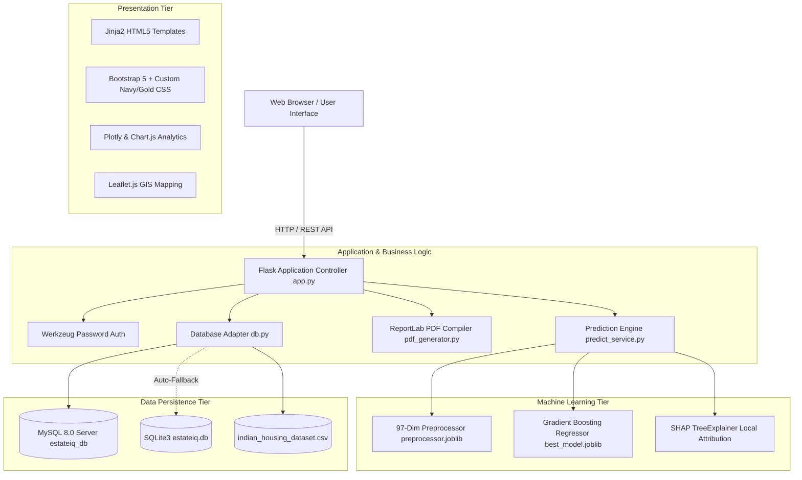
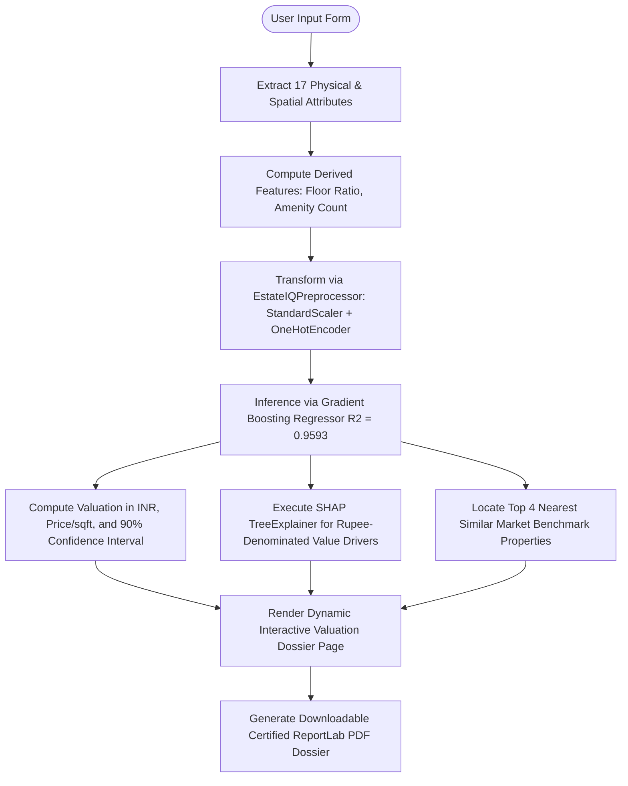
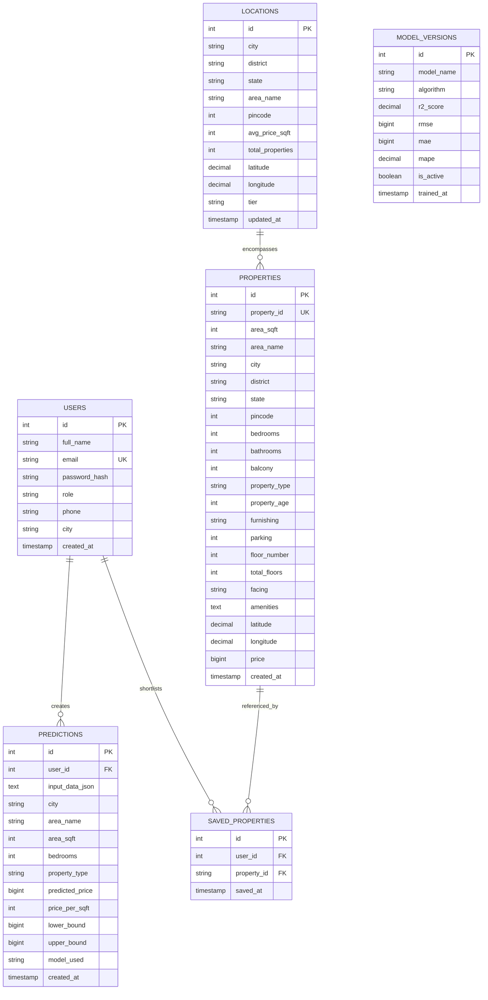

# ESTATEIQ – AI-Powered House Price Prediction and Real Estate Analytics System for Indian Cities

<div align="center">

[](https://rajalakshmi369-raj.github.io/estateiq/)
[](https://github.com/rajalakshmi369-raj/estateiq/archive/refs/heads/main.zip)
[-DC2626?style=for-the-badge&logo=adobeacrobatreader&logoColor=white)](https://github.com/rajalakshmi369-raj/estateiq/raw/main/docs/ESTATEIQ_Final_Project_Report.pdf)
[-2563EB?style=for-the-badge&logo=microsoftword&logoColor=white)](https://github.com/rajalakshmi369-raj/estateiq/raw/main/docs/ESTATEIQ_Final_Project_Report.docx)

### 👉 **[https://rajalakshmi369-raj.github.io/estateiq/](https://rajalakshmi369-raj.github.io/estateiq/)** 👈
*(Anyone can touch or click the link above on mobile or PC to immediately run the live interactive dashboard!)*

</div>

---

**Enterprise Automated Valuation Models (AVM) & Spatial Analytics Platform**

---

## 🏢 Executive Overview

**ESTATEIQ** is an institutional-grade, AI-driven residential real estate valuation and spatial analytics web application engineered specifically for the dynamic property landscape of Indian metropolitan corridors. By synthesizing multi-variable econometric principles with state-of-the-art ensemble machine learning algorithms (Gradient Boosting, XGBoost, Random Forest, Decision Tree, Linear Regression) and game-theoretic SHAP (SHapley Additive exPlanations) interpretability, ESTATEIQ eliminates the traditional black-box opacity of Automated Valuation Models (AVMs).

The system models **21 spatial, architectural, directional (Vastu facing), vertical elevation (floor ratio), and society lifestyle attributes** across **3,200 transaction records** and **61 micro-market localities** spanning 12 Indian metropolitan cities: Mumbai, Delhi NCR, Bengaluru, Hyderabad, Chennai, Pune, Kolkata, Ahmedabad, Gurgaon, Noida, Jaipur, and Kochi.

---

## 🛠️ Technology Stack

| Layer | Technologies |
|---|---|
| **Backend Framework** | Python 3.14 / 3.11+, Flask 3.1.3, Jinja2, Werkzeug Security |
| **Machine Learning** | Scikit-Learn 1.9.1, XGBoost 3.4.1, Joblib 1.6.0 |
| **Explainability (XAI)**| SHAP 0.54.1 (TreeExplainer game-theoretic local & global attribution) |
| **Data Engineering** | Pandas 3.0.6, NumPy 2.5.4 |
| **Database Management**| MySQL 8.0 (`estateiq_schema.sql`) with seamless SQLite3 zero-config automatic failover |
| **GIS Mapping** | Leaflet.js 1.9.4, OpenStreetMap Tiles, GeoJSON coordinate spatial mapping |
| **Interactive Analytics**| Plotly.js 2.30.0, Chart.js 4.4.2 |
| **PDF Generation** | ReportLab 5.1.0 (Automated valuation dossiers with confidence intervals) |
| **Frontend UI/UX** | HTML5, CSS3, JavaScript (ES6+), Bootstrap 5.3.3, FontAwesome 6, Custom Navy/Gold Theme |

---

## 🏛️ System Architecture



---

## 🔄 End-to-End Prediction Flowchart



---

## 🗄️ Relational Entity-Relationship (ER) Diagram



---

## 🏆 Machine Learning Benchmarking Results

All five algorithms were trained on 2,560 records and rigorously validated on 640 unseen holdout test records:

| Regression Algorithm | MAE (₹) | RMSE (₹) | R² Score | Train R² | MAPE (%) | Ranking |
|---|---|---|---|---|---|---|
| **Gradient Boosting Regressor** | **₹ 25,58,616** | **₹ 47,91,877** | **0.9593** | **0.9781** | **10.59%** | 🥇 **Best Model** |
| **XGBoost Regressor** | ₹ 27,80,842 | ₹ 49,68,980 | 0.9562 | 0.9810 | 11.54% | 🥈 Second Best |
| **Random Forest Regressor** | ₹ 41,48,199 | ₹ 67,30,088 | 0.9197 | 0.9654 | 20.36% | 🥉 Third Best |
| **Decision Tree Regressor** | ₹ 54,50,376 | ₹ 91,13,484 | 0.8528 | 0.9312 | 26.27% | Baseline Tree |
| **Linear Regression (OLS)** | ₹ 57,66,571 | ₹ 1,06,97,962| 0.7971 | 0.8142 | 36.99% | Baseline Linear |

---

## ✨ 10 Main Features Summary

1. **Home Page & Portal Gateway (`/`)**: Navy Blue + White + Gold luxury aesthetic, interactive state/city search, live property counters, and featured listing cards.
2. **Smart House Price Prediction (`/predict`)**: Validated 17-attribute input form with dynamic cascading location selector, multi-select society amenities, algorithm chooser, and real-time inference.
3. **India Spatial Location Intelligence (`/location-intelligence`)**: Leaflet.js GIS interactive mapping with custom color-coded markers for Super-Luxury, Premium, and Mid-Affordable tiers across 61+ Indian localities.
4. **Market Analytics Dashboard (`/analytics`)**: Interactive Plotly and Chart.js charts covering city average prices, state capital deployment, BHK scaling, age depreciation curves, and Pearson correlation heatmap.
5. **Property Comparison Matrix (`/comparison`)**: Side-by-side benchmark of up to 3 properties with synchronized dual-axis charts and feature differential highlighting.
6. **Smart Recommendations Engine (`/recommendations`)**: Filter inventory by budget ceiling, city corridor, BHK configuration, asset type, and minimum carpet area.
7. **AI Price Explanation (`/explainability`)**: SHAP TreeExplainer attribution charts explaining why the model assigned a specific valuation in Indian Rupees.
8. **Budget-Based Property Finder (`/budget-finder`)**: Classifies properties into lowest-priced bargains, maximum space matches, and lowest rate-per-sqft options.
9. **Property Valuation PDF Report (`/download-report`)**: Programmatic compilation of downloadable, certified institutional appraisal reports via ReportLab.
10. **User & Admin Management Dashboards (`/dashboard`, `/admin`)**: Role-based access control, user valuation logs, property bookmarks, and admin model performance telemetry.

---

## 🚀 Quick Start & Installation Guide

### Prerequisites
- Python 3.10+ (Tested on Python 3.14.7)
- Web browser (Chrome, Edge, Firefox)

### Step 1: Install Dependencies
```bash
pip install -r requirements.txt
```

### Step 2: Initialize Database & Train Models (Automated)
```bash
# Generate 3,200 property dataset records
python data/generate_dataset.py

# Train all 5 regression models & save artifacts
python ml/train_models.py

# Initialize database schema & seed tables
python database/db.py
```

### Step 3: Run Web Application
```bash
python app.py
```
Or double-click `start_estateiq.bat`.

Open your browser at: **`http://127.0.0.1:5000`**

---

## 🔑 Default Credentials

- **Administrator Account:**
  - Email: `admin@estateiq.in`
  - Password: `admin123`
- **Demo User Account:**
  - Email: `user@estateiq.in`
  - Password: `user123`

*(One-click autofill buttons are built directly into the `/login` interface for instant testing!)*
